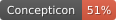

# CLDF dataset derived from Gauchat et al.'s "Tableaux phonétiques des patois suisses romands" from 1925

## How to cite

If you use these data please cite
- the original source
  > Gauchat, L.; Jeanjaquet, J. & Tappolet, E. (1925): Tableaux phonétiques des patois suisses romands Attinger: Neuchâtel.
- the derived dataset using the DOI of the [particular released version](../../releases/) you were using

## Description

This dataset is licensed under a CC-BY-4.0 license

Available online at https://tppsr.clld.org

Conceptlists in Concepticon:
- [Gauchat-1925-480](https://concepticon.clld.org/contributions/0)
## Notes

The source of this dataset is available at https://archive.org/details/gauchat-et-al-1925-tppsr

### Coverage

## Statistics

- **Varieties:** 62 (linked to 1 different Glottocodes)
- **Concepts:** 480 (linked to 243 different Concepticon concept sets)
- **Lexemes:** 29,464
- **Sources:** 158
- **Synonymy:** 1.00
- **Invalid lexemes:** 0
- **Tokens:** 166,535
- **Segments:** 398 (0 BIPA errors, 0 CLTS sound class errors, 398 CLTS modified)
- **Inventory size (avg):** 81.55

# Contributors

Name               | GitHub user | Description | Role
---                | ---         | --- | ---
Hans Geisler | | maintainer | Editor
Robert Forkel | @xrotwang | maintainer | Editor
Johann-Mattis List | @lingulist | maintainer | Editor
Gauchat, L. | | original data collection | Author
Jaenjaquet, J. | | original data collection | Author
Tappolet | | original data collection | Author

## CLDF Datasets

The following CLDF datasets are available in [cldf](cldf):

- CLDF [Wordlist](https://github.com/cldf/cldf/tree/master/modules/Wordlist) at [cldf/cldf-metadata.json](cldf/cldf-metadata.json)